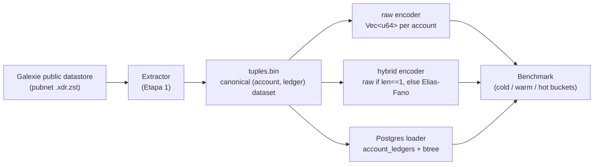

# Compact Stellar Historical Index — V0

> Not an indexer. The compact file for the lake.
> The index accelerates locating the data, not retrieving/decompressing the underlying ledger data.

A falsification experiment: does a succinct encoding (Elias-Fano) of `account → [ledger, ledger, ...]` meaningfully shrink storage while staying fast enough to query — compared to a plain uncompressed `Vec<u64>` and to PostgreSQL? The full frozen spec (what "the account appears in the ledger" means, the binary layout, the buckets) lives in [`SPEC.md`](SPEC.md).

## How it works



## What this tests

| Question | What's compared |
|---|---|
| Does the succinct encoding actually shrink storage? | `compact.bin` (hybrid Elias-Fano) vs. `raw.bin` (`Vec<u64>`, no compression) |
| Does it stay fast enough to query? | mmap point/range lookups vs. PostgreSQL over a composite `(account, ledger)` btree |
| Where does it actually help, if anywhere? | Reported per bucket — `cold` (len==1), `warm` (2..=32), `hot` (>32) — never as one blended number |

## Project layout

```text
compact-stellar-index/
  extractor/     # Stage 1: Galexie XDR -> canonical (account, ledger) tuples, deterministic + hashed
  format/        # Shared binary formats + mmap readers (raw.bin, compact.bin)
  builder/       # Stage 2: tuples.bin -> raw.bin / compact.bin / Postgres (all from the same hash)
  benchmark/     # Bucketed point/range query benchmark across the three representations
  data/out/      # Real run artifacts: hashes, build/benchmark reports, Postgres query plan
```

The experiment had explicit permission to conclude "not worth it," and the result below is reported as measured, not smoothed over.

---

## En español

Estado actual: **Etapa 1 (extractor) + Etapa 2 (builder + reader + benchmark) corridas sobre una sola ventana real de pubnet (`w3_recent`, 5000 ledgers, 64.648.375–64.653.374)**. `w1_early`/`w2_soroban_launch` no se corrieron todavía.

### Hipótesis de partida vs. qué mostró el experimento

| | Se creía / se quería probar | Qué mostró `w3_recent` |
|---|---|---|
| **Pregunta central** | Una representación sucinta (Elias-Fano) puede reducir significativamente el almacenamiento manteniendo latencia útil | No, no en esta ventana: pierde en storage total y en latencia point/range de `cold`/`warm` |
| **Storage vs. raw** | EF debería comprimir mejor que `Vec<u64>` sin comprimir | Perdió — `compact.bin` quedó **15% más grande** que `raw.bin` |
| **Riesgo anticipado (§7 del análisis inicial)** | El overhead fijo de una estructura succinta podría dominar en listas cortas (bucket `cold`, la mayoría de las cuentas) | Confirmado empíricamente: epserde cuesta ~600+ bytes fijos por chunk, iguales para `n=1` o `n=5` — eso es lo que infla `compact.bin` |
| **Latencia vs. raw** | El índice compacto debería seguir siendo rápido aun comprimiendo | Perdió en todo: `cold`/`warm` sin competencia, y en `hot` incluso el range query es un empate rengo (p50 raw 3.96µs vs compact 4.33µs; compact sólo edita la cola, p95 5.21µs vs 5.58µs) |
| **Latencia vs. Postgres** | Evitar el roundtrip cliente-servidor debería ganarle a Postgres por órdenes de magnitud | Confirmado — `raw` y `compact` le ganan a Postgres por 100x–1000x en todos los buckets, sin excepción |
| **¿El experimento tiene permiso de fracasar?** | Sí, explícito desde el planteo original | Se usó: el resultado no se maquilló para que EF "ganara" |

### Resultado (ventana `w3_recent`)

#### Storage (totales, 1.312.596 cuentas / 3.384.425 pares account-ledger)

| Representación | Bytes | vs. raw |
|---|---:|---:|
| `raw.bin` (Baseline A, `Vec<u64>`) | 84.829.648 | 1.00x |
| `compact.bin` (V0 híbrido) | 97.226.216 | **1.15x (más grande)** |
| Postgres (`account_ledgers` + índice btree) | 431.243.264 | 5.08x |

#### Build time

| Representación | Tiempo |
|---|---:|
| `raw.bin` | 0.05s |
| `compact.bin` | 0.10s |
| Postgres (COPY binario + `CREATE INDEX` + `VACUUM ANALYZE`) | 9.35s (3.72s + 5.32s + 0.31s) |

#### Query p50/p95 por bucket (microsegundos; nunca promediado entre buckets)

Universo real: cold (`len==1`) = 1.261.301 cuentas · warm (`2..=32`) = 40.432 · hot (`>32`) = 10.863.
Muestra: 200 cold / 50 warm / top 100 hot, 10 repeticiones por cuenta.

| Bucket | Repr. | Point p50 | Point p95 | Range p50 | Range p95 |
|---|---|---:|---:|---:|---:|
| cold | raw | 0.08 | 423.12 | 0.08 | 0.21 |
| cold | compact | 0.08 | 351.29 | 0.08 | 0.21 |
| cold | postgres | 26.88 | 338.71 | 27.42 | 76.79 |
| warm | raw | 0.08 | 193.04 | 0.08 | 0.21 |
| warm | compact | **1.08** | 242.88 | 1.08 | 1.33 |
| warm | postgres | 26.17 | 180.71 | 25.62 | 31.75 |
| hot | raw | 2.42 | 510.54 | 3.96 | 5.58 |
| hot | compact | 6.50 | 406.08 | **4.33** | 5.21 |
| hot | postgres | 476.50 | 1466.17 | 263.04 | 662.46 |

Postgres usa el índice compuesto tal como se esperaba (`EXPLAIN (ANALYZE, BUFFERS)`: *Index Only Scan*, `Heap Fetches: 0` — ver `data/out/postgres_explain_point.txt`); su lentitud frente a raw/compact es overhead de protocolo cliente-servidor, no un plan de query roto.

### Veredicto (2-3 frases, sin vender un número agregado)

El índice híbrido **pierde en storage total** contra el `Vec<u64>` desnudo (+15%): el 96% de las cuentas cae en `cold`/`warm`, y ahí el overhead fijo de epserde por chunk (~600+ bytes, confirmado empíricamente, independiente de si la lista tiene 1 o 5 elementos) pesa más de lo que Elias-Fano ahorra. En latencia, `raw` gana en `cold`/`warm` sin competencia (acceso directo, sin decodificar nada) y **también gana en `hot`** salvo un empate microscópico e irrelevante en la cola del range query (p95 5.21µs vs 5.58µs) — no hay ningún bucket donde el índice compacto gane de forma clara y consistente. Frente a esta definición de aparición y esta ventana, el experimento apunta a **Resultado D** de los criterios originales: el índice no ofrece ninguna ventaja sobre la alternativa ingenua — sigue vivo sólo si `w1_early`/`w2_soroban_launch` cambian la distribución de longitudes lo suficiente como para que el bucket `hot` pese más.

### Artefactos

- `SPEC.md` — definición congelada (`definition_of_appearance`, formato binario, buckets).
- `data/out/tuples.hash` — hash del dataset canónico de Etapa 1 (`sha256:b51577aa57e579c52a70f200bbe0366156db1c990467fb3ce7a7fee4a35e6e62`).
- `data/out/build_report.json`, `benchmark_report.json`, `benchmark_table.txt` — números crudos.
- `data/out/postgres_explain_point.txt` — plan real verificado.

Los binarios pesados (`tuples.bin` ~122MB, `raw.bin` ~85MB, `compact.bin` ~97MB) **no están versionados** — se regeneran localmente corriendo `extractor` y `builder` sobre la misma ventana (`WINDOW_START`/`WINDOW_END`), y el hash de arriba permite verificar que el `tuples.bin` regenerado es byte-a-byte el mismo que produjo estos números.
